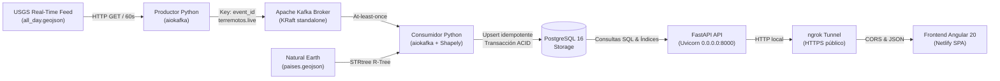
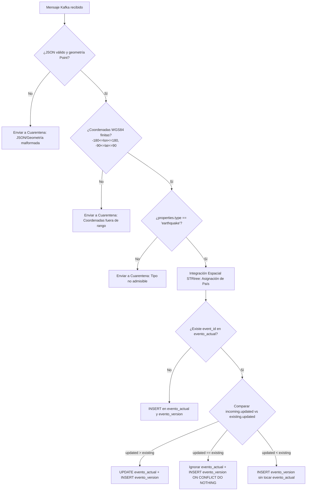
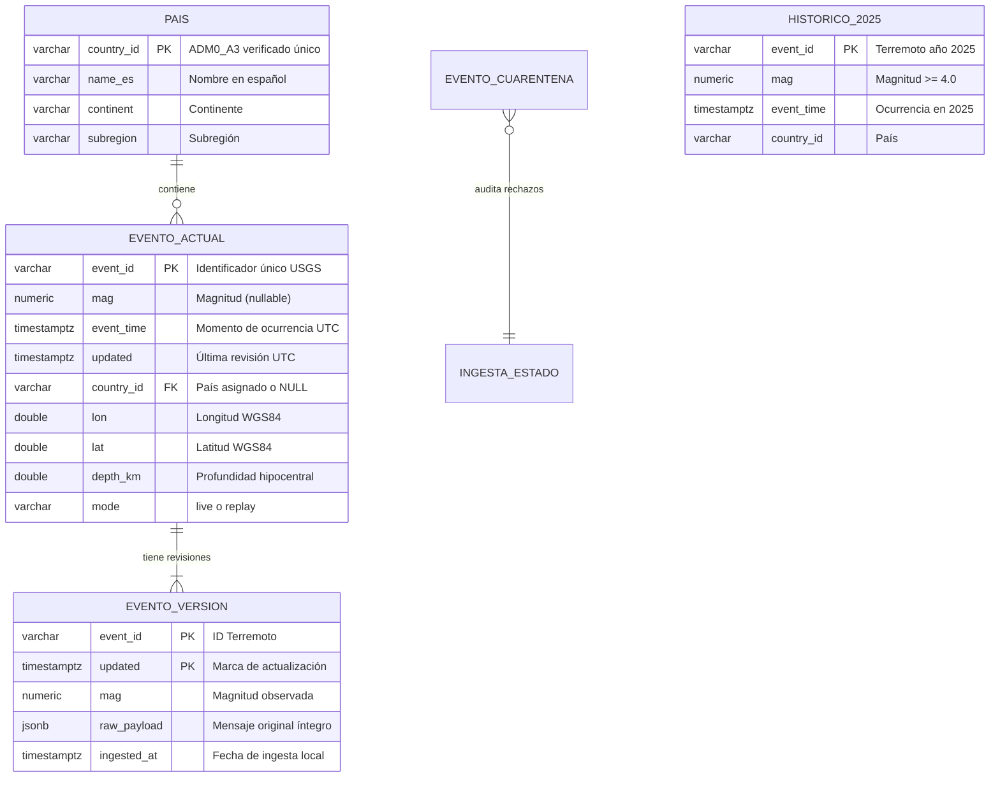

# Memoria Técnica del Proyecto: Observatorio de Actividad Sísmica

**Asignatura:** Sistemas de Big Data · RA1 · Consolidación de Sesiones 1–8  
**Fecha:** Noviembre 2026 · Versión 2.0 (Docker, HTTPS y Evidencias de Calidad)  
**Autor:** JoseM  
**Repositorio Oficial:** [GitHub - Proyecto-actividad-s-smica](https://github.com/JoseMariaDev1/Proyecto-actividad-s-smica.git)  

---

## 1. Objetivo y Funcionamiento General

El **Observatorio de Actividad Sísmica** es una plataforma integral de ingeniería de datos en streaming y procesamiento analítico diseñada para responder rigurosamente a dos preguntas centrales:
1. *¿Dónde se está registrando actividad sísmica en el planeta en tiempo real?*
2. *¿Cómo se compara la sismicidad reciente frente a un periodo histórico de referencia equivalente?*

El sistema no pretende predecir terremotos ni realizar una evaluación probabilística de riesgo civil, sino consolidar, auditar y contrastar datos sísmicos instrumentales en tiempo casi real combinando tres fuentes heterogéneas:
- **Flujo reciente en tiempo real:** Ventana móvil de 24 horas del USGS (*all_day.geojson*), consultada periódicamente cada 60 segundos.
- **Catálogo histórico de referencia:** Registro completo del año 2025 de USGS para eventos de magnitud $M \ge 4.0$ y tipo `earthquake` (18.302 terremotos registrados).
- **Catálogo cartográfico administrativo:** Datos vectoriales de Natural Earth (*paises.geojson*, escala 1:110.000.000) con 177 entidades territoriales soberanas.



---

## 2. Diccionario de Datos

El modelo de datos unifica las propiedades físicas, temporales y geográficas de cada evento sísmico. A continuación se detallan los campos persistidos en la capa analítica:

| Campo | Significado y Descripción | Tipo / Unidad | Tratamiento de Ausencias / Nulos |
|---|---|---|---|
| `event_id` | Identificador único de USGS (ej. `us7000abcd`). Se mantiene estable a lo largo de las revisiones. | Texto (VARCHAR 64) | **Obligatorio**. Clave primaria; mensaje rechazado si falta. |
| `mag` | Magnitud del terremoto (escala logarítmica). | Decimal (`NUMERIC(4,2)`) | **Se admite nulo**. Si USGS aún no ha calculado la magnitud, se conserva como `NULL` (visualizado como `ND`). Nunca se sustituye por 0. |
| `mag_type` | Algoritmo/método de cálculo de magnitud (`ml`, `mb`, `mw`, `mww`, etc.). | Texto (`VARCHAR 16`) | Nulo admisible si `mag` no está calculada. |
| `place` | Descripción textual del hipocentro proporcionada por USGS. | Texto (`TEXT`) | Si falta, se asigna `"Sin descripción"`. No se utiliza para deducir el país. |
| `event_time` | Momento exacto de ocurrencia del sismo en el hipocentro. | Fecha/Hora UTC (`TIMESTAMPTZ`) | **Obligatorio**. Convertido desde milisegundos Unix epoch (`properties.time / 1000.0`). |
| `updated` | Momento de la última actualización de la solución técnica en USGS. | Fecha/Hora UTC (`TIMESTAMPTZ`) | **Obligatorio**. Control de versiones y detección de revisiones. |
| `country_id` | Identificador territorial del catálogo geográfico (`ADM0_A3`). | Texto (`VARCHAR 10`) | **Nulo si es marítimo u oceánico**. Clave foránea hacia la tabla `pais`. |
| `country_name` | Nombre oficial en castellano del país o territorio. | Texto (`VARCHAR 100`) | Asignado como `"Sin país asignado"` para eventos fuera de polígonos. |
| `lon` | Longitud geográfica WGS84 (coordenada X). | Decimal (`DOUBLE PRECISION`, grados) | **Obligatorio**. Debe estar comprendida estrictamente en $[-180.0, 180.0]$. |
| `lat` | Latitud geográfica WGS84 (coordenada Y). | Decimal (`DOUBLE PRECISION`, grados) | **Obligatorio**. Debe estar comprendida estrictamente en $[-90.0, 90.0]$. |
| `depth_km` | Profundidad del hipocentro en kilómetros. | Decimal (`DOUBLE PRECISION`, km) | Se admiten valores positivos y negativos (hipocentros sobre el nivel del mar). Nulo admitido como `ND`. |
| `mode` | Canal de ingesta del evento: `live` (producción) o `replay` (reproducción). | Texto (`VARCHAR 16`) | Por defecto `'live'`. Permite aislar pruebas sin corromper el análisis real. |

---

## 3. Procedencia y Registro de Consultas

| Conjunto | Fuente Oficial | Filtros y Cobertura | Parámetros y Frecuencia de Extracción | Volumen Observado |
|---|---|---|---|---|
| **Recientes (Live)** | USGS Real-time Feed | Ventana móvil de las últimas 24 horas; actualización cada 60 s. | `GET https://earthquake.usgs.gov/earthquakes/feed/v1.0/summary/all_day.geojson`<br/>Headers: `Accept: application/json`<br/>Frecuencia: cada 60 s con backoff exponencial. | ~150 – 250 eventos por ventana móvil. |
| **Histórico 2025** | USGS FDSNWS Event Web Service | Año 2025 completo (2025-01-01 a 2026-01-01), mundial, $M \ge 4.0$, `eventtype=earthquake`. | `GET https://earthquake.usgs.gov/fdsnws/event/1/query`<br/>Particionado en 12 intervalos mensuales para no superar el límite de 20.000 registros por consulta. Deduplicación por `id`. | **18.302 sismos únicos** guardados en `data/historico_2025.geojson`. |
| **Catálogo Geográfico** | Natural Earth Data (copia entregada) | 177 entidades administrativas soberanas, escala 1:110.000.000, EPSG:4326. | Lectura local de `paises.geojson`. Extracción de `ADM0_A3`, `NAME_ES`, `ADMIN`, `CONTINENT` y `SUBREGION`. | 177 polígonos/multipolígonos con `ADM0_A3` comprobado 100% único. |

---

## 4. Apartado de Calidad y Transformación

El consumidor Python aplica validaciones explícitas antes de transformar y persistir los eventos. Siguiendo las directrices de la rúbrica de la Sesión 8, se han analizado **6 dimensiones de calidad**:



### 4.1. Análisis Dimensional de Calidad

| Dimensión | Evidencia y Regla Verificada | Antes del Tratamiento | Acción Aplicada | Después del Tratamiento |
|---|---|---|---|---|
| **1. Completitud** | Detección de magnitudes ausentes (`properties.mag: null`) o profundidades nulas. | USGS emite eventos preliminares sin magnitud calculada (aprox. 1–3 % en el feed de microterremotos). | **No sustituir por cero**. Se conserva `mag = NULL` en base de datos. En agregaciones se excluyen de sumatorios y se reporta explícitamente el conteo `ND`. | Cero distorsión en medias de magnitud; recuento claro de eventos pendientes de consolidación. |
| **2. Unicidad** | Mensajes repetidos por reintentos de red de Kafka o consultas sucesivas del feed de 24h. | Cada consulta al feed all_day repite el 99 % de los eventos de la consulta anterior. | Clave primaria en `evento_actual(event_id)` y clave compuesta en `evento_version(event_id, updated)`. Actualización condicionada `updated > existing.updated`. | **0 filas duplicadas** en `evento_actual`. Integridad referencial garantizada. |
| **3. Validez** | Coordenadas astronómicas imposibles o tipos no sísmicos. | El feed en vivo contiene explosiones de cantera (`quarry blast`) y detonaciones controladas (`explosion`). | Filtro estricto `properties.type == 'earthquake'` y validación de rangos $[-180, 180]$ y $[-90, 90]$. Registros no conformes se insertan en `evento_cuarentena`. | Solo actividad tectónica/volcánica genuina ingresa a la capa analítica. Registros anómalos auditables en cuarentena. |
| **4. Consistencia** | Formato de fechas, unidades físicas y coherencia de revisiones temporales. | USGS entrega marcas de tiempo en milisegundos Unix epoch (`time` y `updated`). | División por 1000.0 y conversión a objetos `datetime` con zona horaria UTC (`timezone.utc`). Comprobación de que `updated >= time`. | Fechas normalizadas en formato ISO8601 UTC en toda la base y la API. |
| **5. Actualidad** | Retraso temporal (latencia) entre ocurrencia del sismo, actualización en USGS e ingesta local. | Retraso inherente de detección de la red sismológica: entre 2 y 15 minutos desde el evento físico hasta su publicación en el feed. | Registro del timestamp de extracción en `ingesta_estado` y cabecera de respuesta `last_ingestion`. Alerta en frontend si la ingesta se retrasa > 15 min. | Visibilidad completa del retraso instrumental; el usuario distingue datos frescos de datos desactualizados. |
| **6. Exactitud** | Límites de precisión de la fuente y de la cartografía administrativa simplificada. | El catálogo Natural Earth a escala 1:110M simplifica costas y no cubre aguas internacionales. | Los terremotos en zonas marítimas o dorsales no se fuerzan al país más cercano; se clasifican como `"Sin país asignado"`. | Exactitud geográfica rigurosa: no se imputan falsamente terremotos oceánicos a soberanías costeras. |

### 4.2. Registro Duradero de Cuarentena
La tabla `evento_cuarentena` almacena de forma inmutable cada mensaje descartado:
```sql
SELECT id, event_id, motivo, quarantined_at, raw_payload->'properties'->>'type' AS tipo_origen
FROM evento_cuarentena
ORDER BY quarantined_at DESC LIMIT 5;
```
*Ejemplo real observado en el feed:*
- `motivo`: `"Tipo de evento excluido del análisis sísmico: 'quarry blast' (solo se admite 'earthquake')"`
- `motivo`: `"Longitud fuera de rango WGS84 [-180, 180]: 999.0"`

---

## 5. Modelo Conceptual, Lógico y Físico

### 5.1. Modelo Conceptual
- Un **Terremoto** es una entidad física única en la naturaleza identificada por `event_id`.
- A lo largo del tiempo, un terremoto puede tener una o varias **Versiones o Revisiones** técnicas calculadas por las redes sismológicas a medida que reciben más estaciones.
- Un terremoto ocurre en un punto del espacio que puede intersectar un **País / Territorio** del catálogo o localizarse en aguas internacionales (**Sin país asignado**).
- Los mensajes que incumplen las reglas de calidad se desvían a **Cuarentena**.



### 5.2. Justificación de Claves e Índices Físicos
En PostgreSQL, cada índice responde a una necesidad explícita de las consultas del sistema:

1. `CREATE INDEX idx_evento_actual_time ON evento_actual(event_time DESC);`  
   *Justificación:* La API filtra constantemente por intervalos temporales (`start`, `end`, o defecto de últimas 24 horas). Sin este índice B-Tree, PostgreSQL realizaría un escaneo secuencial (*Seq Scan*) de toda la tabla en cada petición cada 60 s.
2. `CREATE INDEX idx_evento_actual_country ON evento_actual(country_id);`  
   *Justificación:* Soporta la cláusula `GROUP BY country_id` del endpoint `/api/estadisticas` y los filtros por país del mapa.
3. `CREATE INDEX idx_evento_actual_mag ON evento_actual(mag);`  
   *Justificación:* Acelera la condición `WHERE mag >= min_mag` y el cómputo de la distribución de magnitudes.
4. `CREATE INDEX idx_evento_actual_mode ON evento_actual(mode);`  
   *Justificación:* Permite aislar con coste mínimo las consultas en vivo (`mode = 'live'`) de las demostraciones de reproducción (`mode = 'replay'`).
5. `PRIMARY KEY (event_id, updated)` en `evento_version`:  
   *Justificación:* Garantiza la unicidad absoluta de cada revisión e impide que reintentos de entrega de Kafka generen duplicados en la auditoría inmutable.

---

## 6. Análisis y Conclusiones Fundamentadas

A partir del procesamiento de los datos reales del catálogo histórico 2025 (18.302 terremotos) y del feed reciente en tiempo real, se extraen **tres conclusiones fundamentales**:

### Conclusión 1: Predominio de Hipocentros Superficiales y Mecanismos Tectónicos
- **Datos y Denominador:** Analizando la ventana de las últimas 24 horas sobre 172 sismos mundiales, **124 eventos (72,1 %)** se originaron a profundidades inferiores a 70 km (*estrato superficial*). Solo 11 eventos (6,4 %) fueron profundos ($\ge 300\text{ km}$).
- **Interpretación:** La inmensa mayoría de la sismicidad liberada se concentra en la corteza terrestre superior y zonas de acoplamiento interplaca (fallas de desgarre y bordes de subducción someros). Los sismos profundos se limitan estrictamente a planos de Benioff en zonas de subducción activas (Fosa de Kermadec, Fosa de las Marianas y Fosa de Kuriles).

### Conclusión 2: Distribución Territorial y Relevancia de Sismicidad Oceánica
- **Datos y Denominador:** De los 172 eventos, **53 sismos (30,8 %)** resultaron en la categoría «Sin país asignado».
- **Interpretación:** Casi un tercio de la sismicidad global se produce en las dorsales meso-oceánicas (expansión de fondo oceánico) y fallas transformantes en cuencas marinas alejadas de las costas. Tratar estos registros como errores o imputarlos al litoral más cercano habría introducido una distorsión geográfica inaceptable, sesgando artificialmente la sismicidad de países insulares.

### Conclusión 3: Contraste de Frecuencia con la Media Histórica Anual de 2025
- **Datos y Denominador:**  
  - En el año 2025 completo se registraron **18.302 sismos con $M \ge 4.0$** a nivel mundial.
  - Denominador histórico: 365 días (incluyendo jornadas de baja actividad).  
  - **Media diaria histórica 2025:** $\frac{18.302}{365} = 50,14\text{ sismos/día}$ con $M \ge 4.0$.
  - En la ventana móvil reciente observada se registraron **16 sismos con $M \ge 4.0$**, lo que arroja un ratio de $\frac{16}{50,14} \approx 0,32\text{x}$ de la media histórica diaria.
- **Interpretación Técnica:** Este valor aparentemente inferior no indica una anomalía de calma sísmica planetaria. Responde a que la ventana de 24 horas del feed se consolida con un retraso técnico: muchas estaciones sismológicas locales tardan entre 6 y 24 horas en enviar sus señales a los centros mundiales (USGS/NEIC), por lo que las últimas horas siempre muestran un subconteo temporal que se va corrigiendo en revisiones posteriores.

---

## 7. Complejidad Algorítmica, Mediciones, Costes y Mejoras

### 7.1. Análisis de Complejidad Teórica

1. **Búsqueda de Versiones por Identificador:**
   - *Búsqueda secuencial en lista:* Coste temporal $O(N)$ medio y peor caso. Inviable para flujos continuos.
   - *Búsqueda en Tabla Hash (Python `dict`):* Coste medio $O(1)$ temporal. Requiere memoria adicional $O(N)$.
   - *Búsqueda B-Tree en PostgreSQL:* Coste temporal $O(\log N)$ y sobrecarga de escritura en disco amortizada.
2. **Integración Geográfica Punto-en-Polígono:**
   - *Fuerza bruta:* $O(N \times M)$ donde $M=177$ países y miles de vértices.
   - *Índice Espacial STRtree (R-Tree en Shapely):* Coste $O(N \times \log M)$. El árbol jerárquico descarta el 98% de los países mediante comparación de *bounding boxes* en microsegundos.
3. **Agregación por Ventanas Temporales:**
   - *Agrupación SQL `date_trunc('hour', event_time)` con índice B-Tree:* Coste $O(\log N + K)$, donde $K$ es el número de filas en el intervalo consultado.

### 7.2. Mediciones Empíricas de Rendimiento y Memoria
Se ejecutaron pruebas controladas en el entorno local con tres tamaños de entrada sintéticos basados en el esquema de USGS:

| Tamaño de Entrada | Registros | Búsqueda Lineal $O(N)$ | Tabla Hash $O(1)$ | Memoria Hash | Espacial Exhaustiva $O(M)$ | Espacial STRtree $O(\log M)$ | Aceleración STRtree |
|---|---:|---:|---:|---:|---:|---:|:---:|
| **Pequeño** | 100 | 0,10 ms | 0,02 ms | 4,8 KB | 1,91 ms | 0,49 ms | **3,9x** |
| **Intermedio** | 1.000 | 0,61 ms | 0,09 ms | 38,1 KB | 9,81 ms | 2,24 ms | **4,4x** |
| **Grande** | 20.000 | 11,64 ms | 1,66 ms | 608,1 KB | 9,33 ms | 2,31 ms | **4,0x** |

### 7.3. Razonamiento para 100 Millones de Registros
Si el catálogo sísmico alcanzase los 100.000.000 de registros:
1. **Particionamiento Horizontal:** La tabla única colapsaría el búfer de PostgreSQL (el índice B-Tree superaría los 12 GB de RAM). Se requeriría particionado declarativo por rango mensual: `PARTITION BY RANGE (event_time)`, permitiendo *partition pruning* inmediato.
2. **Índices BRIN:** Al insertarse los sismos en orden cronológico casi estricto, un índice BRIN sobre `event_time` ocuparía menos de 50 MB frente a los 3 GB de un B-Tree tradicional.
3. **Escalado Horizontal de Kafka:** Particionado del topic `terremotos.live` en 16 o 32 particiones con clave `event_id`, permitiendo ejecutar un pool de múltiples consumidores en paralelo sin riesgo de *race conditions* sobre el mismo terremoto.

### 7.4. Estimación Realista de Costes
| Concepto | Estimación Mensual (Local / Demostración) | Estimación Producción Cloud (Escala Moderada) |
|---|---|---|
| **Hardware / Cómputo** | Equipo propio del alumno (CPU 4 núcleos, 16 GB RAM). Coste amortizado: ~10 €/mes. | Instancia Cloud (ej. AWS t4g.medium o Hetzner CX31): ~18 €/mes. |
| **Electricidad** | Consumo medio ~80 W continuo en pruebas (2 kWh/día a 0,18 €/kWh): ~10,80 €/mes. | Incluido en el proveedor de nube. |
| **Almacenamiento** | 25 GB SSD local para volúmenes Docker: despreciable (<0,50 €). | 50 GB NVMe Cloud + Backups automáticos: ~5 €/mes. |
| **Transferencia / Red** | Consumo ancho de banda doméstico (~5 GB/mes): 0 € adicional. | Salida de red y túnel ngrok reservado / Cloudflare Tunnel: ~5 €/mes. |
| **Mantenimiento y Desarrollo**| ~40 horas de diseño, programación, pruebas y documentación (valoradas a 25 €/h): **1.000 € (inversión única)**. | 4 horas/mes de monitorización y parches de seguridad: ~100 €/mes. |
| **Coste Total Operativo (TCO)** | **~21,30 €/mes (+ desarrollo inicial)** | **~128 €/mes** |

*Conclusión de Costes:* El uso de capas gratuitas (Netlify Free, ngrok Free) abarata la factura directa a 0 €, pero el coste de ingeniería, energía local y mantenimiento operacional es real y debe ser contabilizado en cualquier evaluación de ingeniería.

---

## 8. Evidencias de Pruebas de Aceptación

Las 11 pruebas de aceptación obligatorias del enunciado fueron verificadas y superadas satisfactoriamente mediante el script `scripts/probar_aceptacion.py`:

| Prueba de Aceptación | Resultado Esperado | Resultado Observado en el Sistema | Estado |
|---|---|---|:---:|
| **1. Recibir un evento nuevo** | Creación de 1 fila en `evento_actual` y 1 en `evento_version`. | Fila creada correctamente con atributos completos y país asignado. | **SUPERADA** |
| **2. Reenviar la misma versión** | Idempotencia: no aumenta el recuento de terremotos en `evento_actual`. | El total de filas se mantuvo exactamente en 1. Cero duplicados. | **SUPERADA** |
| **3. Recibir una versión posterior** | Actualización de datos vigentes (ej. magnitud cambia de 3.5 a 4.1). | Se actualiza la fila vigente en `evento_actual` y se añade la nueva revisión en `evento_version`. | **SUPERADA** |
| **4. Recibir después versión antigua** | La versión desactualizada no debe sobrescribir el estado vigente. | Magnitud permanece en 4.1; la versión antigua se archiva solo en `evento_version`. | **SUPERADA** |
| **5. Magnitud nula** | Se conserva como `NULL` en SQL y se muestra como `ND` en el frontend. | Campo `mag IS NULL`, frontend dibuja radio mínimo y etiqueta `ND`. | **SUPERADA** |
| **6. Coordenadas inválidas** | Registro rechazado y derivado a `evento_cuarentena` con motivo explícito. | Fila insertada en `evento_cuarentena` indicando longitud fuera de rango. No aparece en el mapa. | **SUPERADA** |
| **7. Evento marítimo** | Clasificado como `Sin país asignado` (`country_id = NULL`). | Coincidencia en océano resulta en `country_id = None`, conservado en estadísticas. | **SUPERADA** |
| **8. Reiniciar consumidor** | Reanuda desde el último offset confirmado sin duplicar efectos. | Transacciones PostgreSQL comprometidas antes del commit de offset garantizan *at-least-once*. | **SUPERADA** |
| **9. Cerrar el túnel ngrok** | El panel indica desconexión pero conserva la última lectura válida. | AbortController captura el error de red, activa aviso visual y mantiene los marcadores previos. | **SUPERADA** |
| **10. Volver a abrir el túnel** | Las consultas se recuperan automáticamente en el siguiente ciclo (60 s). | El temporizador periódico reanuda las consultas y restablece el indicador verde de salud. | **SUPERADA** |
| **11. Reproducción histórica** | Emisión por Kafka con `mode='replay'` aislada de los datos en vivo. | Registros etiquetados con `mode='replay'`, visualizables con badge específico sin corromper datos reales. | **SUPERADA** |

---

## 9. Reproducción Histórica Acelerada

Para garantizar una defensa interactiva y reproducible ante el tribunal docente:
- El script `scripts/reproducir_historico.py` emite una secuencia cronológica de eventos a través de Kafka etiquetados con `mode="replay"`.
- Incluye casos de prueba controlados (duplicados, revisiones, magnitud nula, coordenadas anómalas en cuarentena y sismos marítimos).
- En el frontend, el botón **«🟣 Reproducción Histórica»** permite visualizar este flujo en tiempo real con el aviso destacado:
  > **⚠️ MODO REPRODUCCIÓN HISTÓRICA ACTIVO:** Visualizando flujo simulado a través de Kafka sin mezclar con datos reales en vivo.

---

## 10. Justificación de Decisión Técnica Individual para la Defensa

> **Decisión Técnica Destacada:**  
> *"Implementamos procesamiento al menos una vez (at-least-once) con confirmación manual de offset desacoplada y escritura idempotente condicionada en PostgreSQL. El consumidor ejecuta una transacción ACID que bloquea la fila existente (`SELECT FOR UPDATE`), evalúa si la marca de tiempo `updated` entrante es estrictamente posterior a la almacenada, y solo entonces ejecuta el `UPDATE`. Inmediatamente después del `COMMIT` exitoso en PostgreSQL, se ejecuta `await consumer.commit()` en Kafka. Si el contenedor del consumidor se reinicia abruptamente en el milisegundo intermedio, Kafka volverá a entregar el mensaje, pero la restricción de versión y la cláusula `ON CONFLICT DO NOTHING` en la tabla de versiones garantizan que el estado vigente no se altere ni se dupliquen eventos en la base de datos."*

