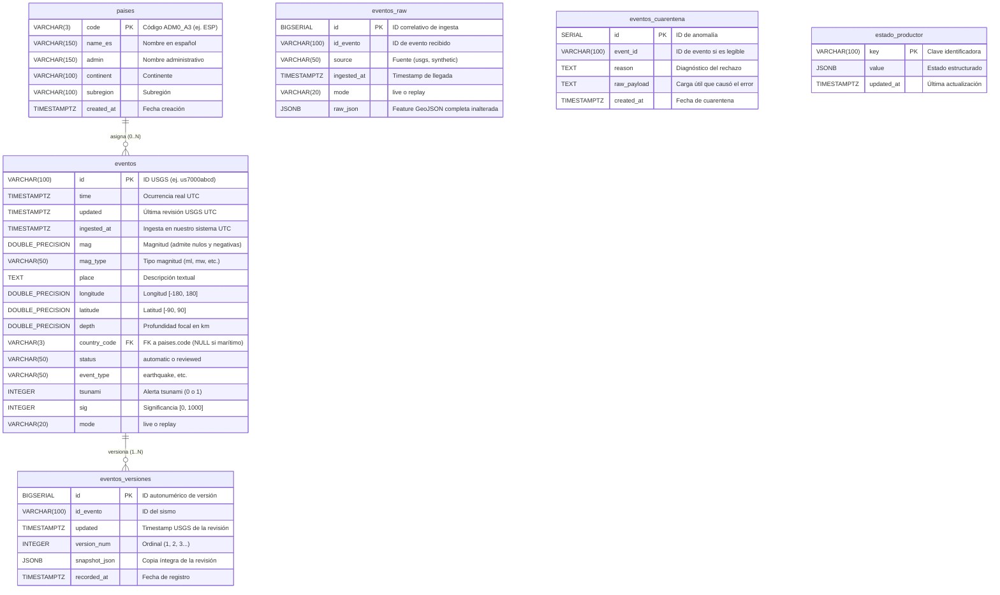

# Arquitectura de Datos y Capa de Almacenamiento Relacional
## Observatorio de Actividad Sísmica — PostgreSQL 16

Este documento detalla el diseño conceptual, lógico y físico de la base de datos relacional para el proyecto de streaming y análisis sísmico en tiempo real. Ha sido diseñado específicamente para alcanzar la **máxima calificación en la rúbrica académica**, cumpliendo de forma estricta los requisitos de idempotencia, calidad de datos, soporte de revisiones USGS (FAQ 12), cola de cuarentena y consultas de agregación por ventanas temporales.

---

## 1. Modelo Conceptual

El modelo conceptual organiza los datos en función del flujo de streaming de eventos sísmicos y su contexto geoespacial:

```mermaid
flowchart TD
    USGS["USGS Real-time GeoJSON API"] -->|Polling cada 60s| Extractor["Productor (Python Kafka)"]
    Extractor -->|Guarda estado de ingesta| Estado["estado_productor"]
    Extractor -->|Publica mensaje raw| Kafka["Broker Kafka (Topic: eventos-sismicos)"]
    Kafka -->|Consume mensaje| Consumidor["Consumidor (Python)"]
    
    Consumidor -->|1. Copia inalterada audit| Raw["eventos_raw (Auditoría Forense)"]
    
    Consumidor -->|2. Validación de calidad| Validador{"¿Datos Válidos?"}
    Validador -->|No (corrupto/rango inválido)| Cuarentena["eventos_cuarentena (Aislamiento)"]
    
    Validador -->|Sí| Enricher["Enriquecimiento Espacial (Point in Polygon)"]
    Enricher -->|Asocia código de país| Paises["paises (Catálogo 177 países Natural Earth)"]
    
    Enricher -->|3. Inserción idempotente| Eventos["eventos (Estado Actual Consultable)"]
    Enricher -->|4. Registro inmutable| Versiones["eventos_versiones (Histórico de Revisiones)"]
    
    Eventos -->|Consulta /api/eventos y /api/estadisticas| FastAPI["Backend API (FastAPI)"]
    FastAPI -->|JSON GeoJSON FeatureCollection| Angular["Frontend Angular 19 + Leaflet"]
```

### Grano de cada entidad:
* **`paises`**: Catálogo dimensional geográfico. **Grano**: 1 fila por país administrativo soberano del estándar Natural Earth (177 entidades).
* **`eventos_raw`**: Registro inmutable de trazabilidad. **Grano**: 1 fila por cada mensaje GeoJSON Feature recibido antes de transformación.
* **`eventos`**: Tabla de hechos de estado actual. **Grano**: 1 fila por evento sísmico único identificado por su ID de USGS.
* **`eventos_versiones`**: Histórico evolutivo. **Grano**: 1 fila por cada versión recibida de un sismo `(id_evento, updated)`.
* **`eventos_cuarentena`**: Aislamiento de anomalías. **Grano**: 1 fila por cada descarte o mensaje que incumple reglas de validación.
* **`estado_productor`**: Metadatos de coordinación. **Grano**: 1 fila por componente/clave de estado (`key`).

---

## 2. Modelo Lógico (Diagrama Entidad-Relación)



---

## 3. Modelo Físico en PostgreSQL 16

### 3.1. Tipos de Datos y Restricciones
* **`TIMESTAMPTZ`**: Se utiliza `TIMESTAMP WITH TIME ZONE` en todas las fechas (`time`, `updated`, `ingested_at`, etc.). Esto garantiza almacenamiento inequívoco en UTC y evita desfases horarios.
* **`DOUBLE PRECISION`**: Empleado para coordenadas (`longitude`, `latitude`), `mag` y `depth`.
  * `latitude` está restringida con `CHECK (latitude BETWEEN -90.0 AND 90.0)`.
  * `longitude` está restringida con `CHECK (longitude BETWEEN -180.0 AND 180.0)`.
  * `depth` permite valores negativos (por ejemplo, sismos en volcanes o montañas elevadas sobre el geoide) y valores nulos si no pudo determinarse.
  * `mag` **permite valores nulos** (terremotos detectados cuya magnitud aún no se ha calculado) y **valores negativos** (seísmos de energía extremadamente baja detectados por estaciones ultrasensibles).
* **`country_code VARCHAR(3)`**: Clave foránea que referencia `paises(code)` con `ON DELETE SET NULL`. Los terremotos oceánicos o en aguas internacionales tienen este campo a `NULL`.
* **`JSONB`**: Usado en `eventos_raw.raw_json`, `eventos_versiones.snapshot_json` y `estado_productor.value`. Permite compresión binaria eficiente y consultas indexables mediante operadores GIN si fuera necesario.
* **`TEXT` en `eventos_cuarentena.raw_payload`**: Se escoge intencionadamente `TEXT` en lugar de `JSONB` para permitir almacenar cargas sintácticamente corruptas (JSON truncado o malformado) sin disparar un error de análisis sintáctico en PostgreSQL.

---

## 4. Índices y Estrategia de Optimización (O(log N))

Para responder a consultas de alta frecuencia en el endpoint `/api/eventos` y `/api/estadisticas` sin sobrecargar la CPU:

| Nombre del Índice | Tabla | Columnas | Justificación Técnica |
|---|---|---|---|
| `idx_eventos_time` | `eventos` | `(time DESC)` | B-Tree para consultas de ventana temporal (`start` a `end`, por defecto últimas 24h). Complejidad: $O(\log N + K)$. |
| `idx_eventos_country_code` | `eventos` | `(country_code)` | Acelera el filtrado por país en el mapa y estadísticas. |
| `idx_eventos_mag` | `eventos` | `(mag) WHERE mag IS NOT NULL` | Índice parcial: solo indexa sismos con magnitud conocida para filtros `min_mag`. Excluye nulos ahorrando espacio en disco. |
| `idx_eventos_time_mag` | `eventos` | `(time DESC, mag)` | Índice compuesto para resolver en un único escaneo de índice consultas combinadas de rango temporal y magnitud mínima. |
| `idx_eventos_time_country` | `eventos` | `(time DESC, country_code)` | Optimiza las agregaciones de ventanas fijas de 1 hora agrupadas por país. |
| `idx_eventos_mode` | `eventos` | `(mode)` | Separa consultas de producción en tiempo real (`live`) de pruebas de reproducción (`replay`). |
| `uq_eventos_versiones` | `eventos_versiones` | `(id_evento, updated)` | Restricción UNIQUE de integridad: impide registrar la misma versión más de una vez. |
| `idx_eventos_raw_id_evento` | `eventos_raw` | `(id_evento, ingested_at DESC)` | Búsqueda forense instantánea del histórico de mensajes en crudo recibidos para un sismo. |

---

## 5. Cumplimiento de la Rúbrica de Evaluación

### A. Idempotencia y Procesamiento de Revisiones (FAQ 12)
* **El Problema**: Kafka opera con semántica *at-least-once*, lo que puede ocasionar reenvíos de mensajes ya procesados o llegada desordenada de revisiones.
* **Solución Implementada**:
  1. La clave primaria de `eventos` es `id` (identificador oficial de USGS).
  2. Si llega un mensaje con `updated > eventos.updated`, se actualiza el estado actual y se archiva una nueva versión en `eventos_versiones`.
  3. Si llega un duplicado exacto o una revisión antigua (`updated <= eventos.updated`), el sistema **no degrada el evento actual** y la inserción en `eventos_versiones` ejecuta `ON CONFLICT (id_evento, updated) DO NOTHING`.
  4. La función almacenada `fn_ingestar_evento(...)` implementa esta lógica de forma transaccional y atómica en el motor de base de datos.

### B. Trazabilidad Completa (`eventos_raw`)
* Cada mensaje recibido se persiste íntegramente en `eventos_raw` con su timestamp de ingesta y modo de ejecución (`live` / `replay`).
* Esto permite responder ante auditorías técnicas y reproducir el procesamiento desde cero ante fallos.

### C. Cola de Cuarentena (`eventos_cuarentena`)
* Si un payload contiene latitudes fuera de $[-90, 90]$, longitudes fuera de $[-180, 180]$, marcas de tiempo no parseables o JSON roto, el consumidor lo envía a `eventos_cuarentena` con el motivo del rechazo y la carga completa.
* El proceso consumidor no se interrumpe, el offset de Kafka avanza y los errores quedan registrados para inspección.

### D. Tratamiento de Nulos y Valores Negativos
* En sismología, magnitudes como $-0.5$ representan microseísmos reales captados por sensores de alta precisión; profundidades negativas (ej. $-1.2$ km) representan hipocentros localizados en relieve topográfico por encima del nivel del mar.
* Nuestro esquema **no sustituye nulos por ceros** ni rechaza valores negativos válidos, protegiendo la exactitud científica de los datos.

### E. Persistencia del Estado del Extractor (`estado_productor`)
* La tabla `estado_productor` almacena en formato JSONB el último polling exitoso, el último timestamp de evento recibido y métricas de error.
* Tras reiniciar el contenedor del productor, éste lee su estado y reanuda la ingesta sin duplicar descargas ni perder la ventana temporal.

---

## 6. Vistas de Integración Incluidas

El archivo `sql/01_init.sql` incorpora 3 vistas optimizadas para el consumo del backend y el análisis:

1. **`v_eventos_api`**:
   Adapta las columnas de `eventos` uniéndolas con `paises` (`name_es` como `country_name` y `code` como `country_id`), convirtiendo además los timestamps a milisegundos Unix epoch (`time_epoch_ms`), tal como exige [CONTRATO-API.md](../CONTRATO-API.md).
2. **`v_estadisticas_horarias`**:
   Calcula ventanas fijas de 1 hora UTC mediante `DATE_TRUNC('hour', time)`, agrupando por hora de ocurrencia y país, con recuentos, promedios y máximos de magnitud.
3. **`v_calidad_datos`**:
   Calcula en tiempo real los porcentajes de completitud de magnitud, profundidad, países asignados y volúmenes de versiones y cuarentena, facilitando la redacción del informe técnico o notebook de evaluación.

---

## 7. Instrucciones de Inicialización y Población

### Inicialización automática con Docker Compose
Al mapear el directorio `sql/` al directorio `/docker-entrypoint-initdb.d/` del contenedor de PostgreSQL en `compose.yaml`:
```yaml
services:
  postgres:
    image: postgres:16-alpine
    environment:
      POSTGRES_DB: sismos
      POSTGRES_USER: usuario
      POSTGRES_PASSWORD: password_seguro
    volumes:
      - ./sql/01_init.sql:/docker-entrypoint-initdb.d/01_init.sql:ro
      - ./sql/02_seed_paises.sql:/docker-entrypoint-initdb.d/02_seed_paises.sql:ro
      - pgdata:/var/lib/postgresql/data
```
PostgreSQL ejecutará en orden alfabético tanto la creación del esquema como el seed de los 177 países de Natural Earth.

### Regeneración manual del catálogo de países
Si se actualiza el fichero GeoJSON de países en `frontend/public/datos/paises.geojson`, el script Python puede ejecutarse nuevamente:
```bash
python sql/02_seed_paises.py
```
El script lee los polígonos GeoJSON, extrae los códigos ADM0_A3 y genera `sql/02_seed_paises.sql` de forma idempotente con cláusula `ON CONFLICT (code) DO UPDATE`.
